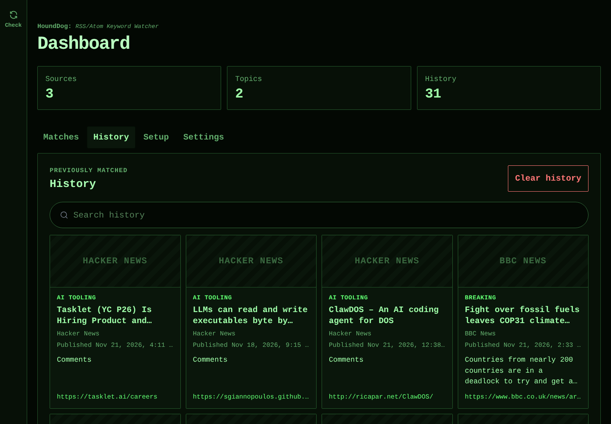

# HoundDog: RSS/Atom Keyword Watcher

HoundDog checks RSS and Atom feeds for new items matching topic keywords. It
includes a terminal watcher and a local dashboard, and remembers seen matches
in SQLite so the same item is not reported again for the same topic.

## Requirements

- Python 3.11 or newer
- Internet access to the configured feeds
- No third-party Python packages

Python 3.12 is known to work with this project.

## Quick start

Open PowerShell in the project directory and run:

```powershell
python watcher.py --validate
python watcher.py --dry-run
python watcher.py
```

- `--validate` checks `watch.toml`, confirms the number of sources and topics,
  and prints the Expat XML parser version in use.
- `--dry-run` shows matches without saving them as seen.
- Running without options checks feeds and records new matches in `watcher.db`.

The first normal run marks all currently matching items as seen. Use
`--dry-run` first if you want to preview results.

The default `watch.toml` and `watcher.db` paths are beside `watcher.py`, so
the commands work even when run from another directory.

## Configuration

Edit `watch.toml`:

```toml
[[sources]]
name = "Hacker News"
url = "https://news.ycombinator.com/rss"

[[topics]]
name = "AI tooling"
keywords = ["LLM*", "agent*", "prompt injection"]
exclude = ["crypto"]
```

Each `[[sources]]` entry provides a feed name and HTTPS or HTTP URL, and
optionally `check_every_minutes` (1-10080) for feeds that update rarely:

```toml
[[sources]]
name = "arXiv cs.LG"
url = "https://export.arxiv.org/api/query?search_query=cat:cs.LG"
check_every_minutes = 1440
```

Such a feed is skipped by checks until that long after the last saved check
that fetched it. Each `[[topics]]` entry contains:

- `name`: a unique label shown in terminal output
- `keywords`: words or phrases that can trigger the topic
- `exclude`: optional words or phrases that prevent a match

Saving feeds or topics from the dashboard rewrites `watch.toml` in a standard
layout, so comments and any keys it does not recognize are dropped. If
`sources` or `topics` is malformed (for example `[sources]` instead of
`[[sources]]`), the dashboard reports the error and refuses to save until the
file is fixed, rather than dropping the entries. Repeated keywords are saved
once, ignoring case.

Keyword matching is case-insensitive and matches whole words. Append `*` to
match word prefixes. For example, `agent*` matches `agent`, `agents`, and
`agentic`. Without `*`, `LLM` does not match `LLMs`.

Item links are stored without tracking parameters (`utm_*`, `fbclid`, BBC's
`at_medium` and similar) or `#fragments`, so one article has one link however
it was shared. An article keeps the headline and dates it had when first seen;
later checks only fill in what was missing. Published dates are also stored as UTC, whatever format the
feed uses; a date whose time zone is unknown (an abbreviation such as CET, or
no zone at all) counts as no date rather than being guessed. Databases from earlier versions are converted once, automatically,
the first time a new version opens them.

### Shared settings

An optional `[settings]` table tunes fetching and history. Every key is
optional; these are the defaults:

```toml
[settings]
fetch_timeout_seconds = 15        # per network read, 1-120
max_feed_megabytes = 5            # larger feeds are rejected, 1-50
user_agent = "keyword-watcher/0.1"
history_retention_days = 90       # 0 keeps everything, up to 3650
max_item_age_days = 0             # ignore items published earlier; 0 is off
event_export = true               # files for other programs; see below
```

The command-line watcher and the dashboard both use this table, and the
dashboard's Settings > Feeds and Settings > Data sections edit it. A whole feed
download may take up to four times `fetch_timeout_seconds`. With a retention
period set, items first seen longer ago are removed after each saved check,
except favorites; an item that is still in its feed can then be reported as
new again the next time that feed changes. `max_item_age_days` skips items
whose published date is older; items without a date are always checked. It
also keeps a first run from reporting a feed's whole backlog.

### Polite fetching

HoundDog tries not to download what has not changed:

- Feeds are requested with gzip compression.
- After a saved check, each feed's `ETag` and `Last-Modified` are remembered.
  The next check sends them back, and an unchanged feed answers "304 Not
  Modified" without a download. Health shows such a feed as unchanged, and says
  for each feed whether it sends these at all; a feed that does not is
  downloaded in full every time.
- Previews and dry runs use these values but never update them. Otherwise the
  next saved check could get a 304 for items it never saved.
- Adding or editing a topic, or changing `max_item_age_days`, downloads every
  feed in full once, so the new rules see everything the feeds still have.
  Clear history does the same.
- A feed that answers 429 or 503 is left alone for as long as its
  `Retry-After` header asks (30 minutes if it does not say, at most 24 hours).
  Checks list it as skipped until then.

## Repeated checks

To keep the watcher running and check every 15 minutes:

```powershell
python watcher.py --interval 15
```

Press `Ctrl+C` to stop. Use `--dry-run --interval 15` to monitor matches
without updating the seen database.

When `watch.toml` is edited while `--interval` is running, the change is
picked up at the next check. An invalid edit is reported and the previous
configuration is kept.

## Automatic checks and the background job

Settings > Checking > Automatic checks chooses who checks your feeds on a
schedule, so only one thing does:

- Off: check by hand with Check in the toolbar.
- This dashboard tab: auto-check every 5 minutes to 1 day while the dashboard
  is open, as Preview only or Check & save. Saved in this browser.
- Background job (Windows): a Windows Task Scheduler task,
  `\HoundDog\Saved check`, runs a saved check on the chosen interval, also
  when the dashboard is closed.

While the background job exists it is the mode in every browser, and their
own auto-checks stay paused. Choosing another option removes the task.

The background job:

- runs `watcher.py --scheduled` with `pythonw.exe`, so no window opens, as you,
  while you are signed in to Windows (a locked screen is fine). A run never
  starts while the previous one is still going.
- has three settings: Run on battery, Catch up on a missed check after sleep or
  shutdown, and Only when connected to a network. All are on by default.
- sends new matches to History and the Inbox, and each run appears in the Log
  as "Background job".
- shows its next and last run and how the last one ended. If the task was
  disabled or edited in Task Scheduler, or its Python moved (for example after
  a Python upgrade), the panel says so and Repair task re-creates it with the
  settings shown.
- has no console, so whatever a run would have printed as a problem (feeds that
  failed, a configuration error, an unexpected error) goes to
  `background-job.log` beside `watcher.db`. The panel shows the newest lines
  under "Messages from background runs", and Clear messages empties it. Runs
  without problems add nothing.

`python watcher.py --scheduled` is what the task runs: one saved check, logged
as a background job. It cannot be combined with `--dry-run` or `--interval`.
Its exit code is the task's last result: 0 for success, 1 when every feed
failed, 2 for a configuration error, and 3 for an unexpected error.

## Command help

```powershell
python watcher.py --help
```

## Dashboard

The optional dashboard is a dependency-free local web application.

### Windows executable

Double-click `HoundDog.exe` to start the server and open the dashboard. It
uses the `watch.toml`, `watcher.db`, and exports beside the executable.
Keep `watch.toml` with the executable if you move it. To stop the dashboard,
open **Shut down** in the left toolbar and confirm, or press Ctrl+C in its
console. A running feed check can finish before the dashboard exits. The
background job is separate and keeps running.

Run `.\build_exe.ps1` from this folder to build or update the executable.
The packaging dependencies live in `.venv-build`. A rebuild replaces the
executable and preserves the app data. Use `.\HoundDog.exe watch --help` for
the bundled watcher CLI. Scheduled checks installed from the executable can
briefly open a console window.

### Run from source

```powershell
python watcher_server.py
```

You can also double-click `start_server.bat` in the project folder. Optional
server arguments are forwarded, for example `start_server.bat --port 8081`.

Then open <http://127.0.0.1:8080>.



The dashboard provides:

- feed source, topic, and History counts
- an editor-style toolbar on the left; its Check tool opens a panel with
  Check & save, Preview only, the result of the last check, and the auto-check
  schedule. Below it:
  - Tester: try a topic's include and exclude keywords against the latest feed
    items or your whole History before saving it. It shows how many items each
    keyword hits, flags keywords that match a large share of items, and lists
    the matches. "Fetch latest items" refreshes the feeds without saving
    anything; Save topic creates or updates the topic
  - Health: each feed's status (OK, unchanged, empty, failing, or not checked
    yet), when it last worked, its last new match, how many checks in a row it
    has failed, and whether it can answer "unchanged" (see Polite fetching). A
    red dot on the Health button means a feed is failing
  - Log: the last 100 checks from the command line, the background job, the
    dashboard, and auto-check, with new matches, feeds checked, duration, and
    failures.
    Previews and dry runs are logged too but never change History. The newest
    1,000 checks are kept in `watcher.db`

  The Settings tool pinned at the bottom opens these sections:
  - Appearance: theme and light/dark mode
  - Display: UI size, and whether to load feed images
  - Checking: automatic checks (off, this dashboard tab, or the background job;
    see Automatic checks above), and desktop notifications for new matches the
    dashboard tab's auto-check finds
  - Feeds: request timeout, maximum feed size, user agent, and the maximum
    item age
  - Data: history retention, the event export for other programs (see Using
    HoundDog with other programs), a full JSON backup (feeds, topics, settings, and
    History with read state and favorites; the check log is not included) or a
    CSV of history, and import of a backup (replace feeds, topics, and
    settings; merge history, keeping your own read state and favorites where
    both have the article)
- an Inbox of saved articles you have not read, one card per article with every
  topic that matched it. Opening an article, from its link or its banner image,
  marks it read; each card can also be marked read or unread, and its star
  adds it to or removes it from your favorites. Mark all read clears what the
  Inbox shows (respecting the search). Favorites are kept past the retention
  period. History can be filtered to All, Unread, or Favorites
- Matches, Inbox, and History as even grids of cards, each with a title, byline,
  dates, matched keywords, a short description, and the link; the banner at the
  top of a card opens the article too. Feed images are off by default, because
  loading one tells the publisher's server your IP address; cards show the
  source name instead
- fuzzy search and pagination on the Matches, Inbox, and History lists; search is
  typo-tolerant, ignores accents, and requires every word you type. Each list
  shows 12 items per page by default, adjustable to 24, 48, or All (which renders
  the whole history at once and can be slow on a large database). Multiples of
  12 keep the last row full whether the grid has 1, 2, 3, or 4 columns
- add, edit, and delete operations for topics and their include/exclude keywords
- preview-only checks that leave History unchanged, and checks that save new matches to History
- add, edit, and delete operations for feed sources
- clearing History (the seen SQLite database)
- themes: Pico by default, plus classic DOS and NES styles, each with light and dark modes

The server listens on `127.0.0.1` only and uses `watch.toml` and
`watcher.db` beside `watcher_server.py`. These files stay the source of truth:
feed and topic changes are written to `watch.toml`, while seen-item history
and reset operations use `watcher.db`. The dashboard does not keep a separate
copy of this data. The selected theme, color mode, UI size, feed images,
the dashboard tab's automatic checks, notifications, items per page, open tab,
History filter, and last Settings section are stored in the browser. Read state and favorites are
stored in `watcher.db`. Use a custom port if needed:

```powershell
python watcher_server.py --port 8081
```

In background checking mode, reload the dashboard to see matches saved by the
scheduled process. An open dashboard does not refresh its Inbox automatically
after that process saves a check.

NES.css is loaded from its pinned 2.3.0 CDN release. The NES theme is offered
only when the stylesheet loads successfully; if it is unavailable, the option
stays hidden and any saved NES selection falls back to Pico. Its rules,
including the pixel cursor, apply only while the NES theme is selected. The
Kongtext font file is served locally.

To use a different configuration or database:

```powershell
python watcher.py --config C:\path\watch.toml --db C:\path\watcher.db
```

When a feed cannot be fetched or parsed, the watcher prints a warning naming
that source and continues with the remaining feeds. It exits with status `1`
when every attempted source fails during a one-shot run. Configuration and
unexpected scheduled-run failures have separate exit codes.

## Dashboard HTTP API

The default base URL is `http://127.0.0.1:8080`. These are local dashboard
endpoints. The server checks Host and Origin, requires JSON for POST and PUT,
and reports JSON errors with an `error` field.

| Method and path | Behavior |
| --- | --- |
| `GET /api/dashboard` | Settings, feeds, topics, and the full History, including read and starred state. |
| `POST /api/check` | Check the configured feeds. Pass `dry_run: true` for a preview. Both modes log the check, but only a saved check adds History and event exports. |
| `POST /api/topic-test` | Test `keywords` and optional `exclude` against the `latest` or `history` corpus. For `latest`, `refresh: true` fetches fresh items for the tester. |
| `GET /api/health`, `GET /api/activity` | Feed health and the most recent logged checks. |
| `POST /api/feeds`, `POST /api/topics` | Append a feed or a topic. Duplicate topic names return HTTP 409. |
| `PUT` or `DELETE /api/feeds/{position}` or `/api/topics/{position}` | Edit or remove a zero-based entry. Send `expected`: the entry as you last read it from `/api/dashboard`. If any editable field differs now (another tab saved first, or the list shifted), the change is refused with HTTP 409. |
| `PUT /api/settings`, `PUT /api/items/state` | Update watcher settings, or set read or starred flags for the supplied article `links`. |
| `GET /api/export?format=json`, `GET /api/export?format=csv` | Download a dashboard backup or a History CSV. The JSON Lines integration export is a separate file stream. |
| `POST /api/import`, `DELETE /api/seen` | Import a JSON backup or clear History. Clearing History leaves the integration exports in place. |
| `GET`, `PUT`, or `DELETE /api/schedule` | Read, install or update, or remove the Windows scheduled task. |
| `POST /api/schedule/run`, `DELETE /api/schedule/log` | Start the installed task or clear its error log. |
| `POST /api/shutdown` | Accept a dashboard server shutdown request. Send an empty JSON object. |

### Backup and restore limits

Every backup HoundDog exports can be imported again. Both sides share one size
limit, 1 GiB: export refuses a larger backup and says to shorten History
retention, and import accepts anything up to that size, with no limit per row
or per field. If you select both configuration
and History, the History merge commits before the configuration file is
replaced. If the file write fails, retrying the backup does not duplicate
History rows.

## Troubleshooting

- The page says "The dashboard server is out of date", or saving a setting
  reports "Unknown API endpoint": an old server is still running. Stop it with
  **Shut down** on its page or `Ctrl+C` in its window, and start
  `start_server.bat` again.
- Starting the server reports "Another HoundDog server is probably still
  running": the port is taken. If you cannot find the old window, PowerShell
  shows which process holds the port, and can stop it:

  ```powershell
  Get-NetTCPConnection -LocalPort 8080 -State Listen | Select-Object OwningProcess
  Stop-Process -Id <OwningProcess>
  ```

## Using HoundDog with other programs

Every saved check (command line, background job, or dashboard) appends what it
found to `exports/hounddog-YYYY-MM-DD.jsonl` beside `watcher.db`, one JSON
object per line, so other programs can use HoundDog's data without reading its
database:

- a coverage record for the check: which feeds were read, and how each went;
- an event for each article it found new, with the topics and keywords that
  matched, when the source released it, and when HoundDog detected it;
- a revision when an article already seen has a new headline or date.

The files are only ever appended to; History retention and Clear history do
not touch them. Previews and dry runs add nothing. If a file cannot be written
(for example while another program has it locked), the records wait in
`watcher.db` and a later check writes them. Turn the export off with
`event_export = false` or in Settings > Data.

[The integration contract](INTEGRATION.md) describes the record formats and
how Bridge uses them.

## Tests

Run the dashboard and watcher test suites from the project directory:

```powershell
node --test tests\dashboard.test.js
python -m unittest discover -s tests -p "test_*.py"
```

The Task Scheduler tests replace PowerShell with a fake, so they run anywhere
and never create a real task.

## Resetting seen items

Stop the watcher, rename or delete `watcher.db`, then run it again:

```powershell
Rename-Item watcher.db watcher.db.backup
python watcher.py --dry-run
```

Deleting or renaming the database loses the list of previously seen items and
the check log behind Health and Log. To clear only History, use Clear history
on the dashboard's History tab. Checks already in progress are discarded when
they finish so the reset stays in effect.
